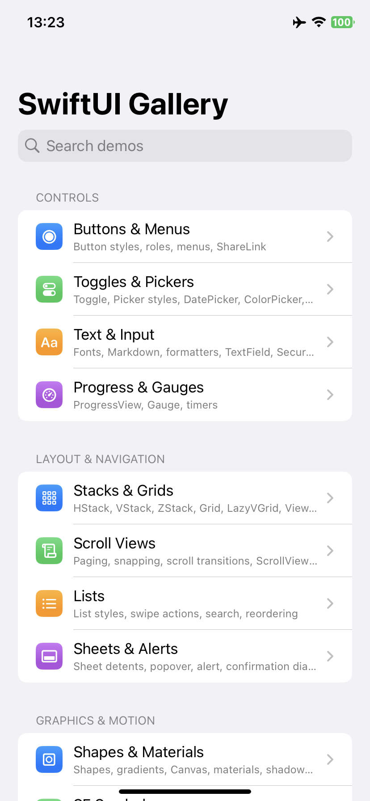
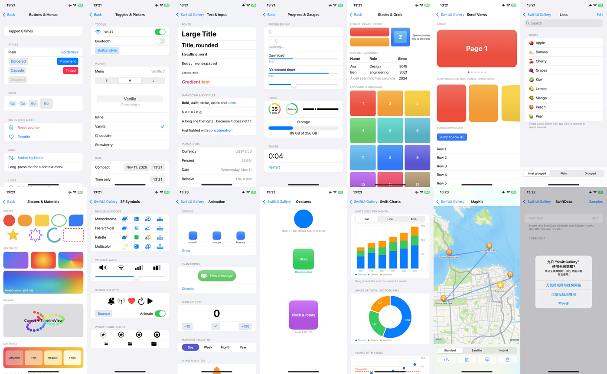

<div align="center">

# SwiftUI Gallery

**English** · [简体中文](README_zh.md)

15 SwiftUI demos in one app: controls, text and formatters, progress and gauges, stacks and grids, scroll views, lists, sheets and alerts, shapes and materials, SF Symbols, animation, gestures, Swift Charts, MapKit and SwiftData.<br/>
Plain SwiftUI with no third-party packages, targeting iOS 17.<br/>
Builds and runs on iPhone from Windows, Linux or macOS with [KXBuild](https://github.com/kxbuild/kxbuild).



</div>

## What's inside

| Section | Demo | Shows |
|---|---|---|
| **Controls** | Buttons & Menus | Button styles, control sizes, roles, `Menu`, context menu, `Link`, `ShareLink` |
| | Toggles & Pickers | `Toggle`, menu / segmented / wheel / inline `Picker`, `DatePicker` (compact, graphical), `ColorPicker`, `Slider`, `Stepper` |
| | Text & Input | Font styles and designs, Markdown, gradient text, format styles, `TextField`, `SecureField`, `TextEditor`, keyboard toolbar |
| | Progress & Gauges | `ProgressView` (indeterminate, value, timer), `Gauge` styles, live timers |
| **Layout & Navigation** | Stacks & Grids | `HStack` / `VStack` / `ZStack`, `Grid` with spanning cells, `LazyVGrid`, `ViewThatFits`, overlays |
| | Scroll Views | Paging, view-aligned snapping, `scrollTransition`, `ScrollViewReader` |
| | Lists | Inset grouped / plain / grouped styles, swipe actions, `searchable`, reordering and multi-select |
| | Sheets & Alerts | Sheet detents, full-screen cover, popover, inspector, alert with a text field, confirmation dialog |
| **Graphics & Motion** | Shapes & Materials | Built-in and custom shapes, linear / radial / angular / mesh gradients, `Canvas` + `TimelineView`, materials, blend modes, masks |
| | SF Symbols | Rendering modes, variable values, symbol effects, weights and scales |
| | Animation | Springs, transitions, numeric text, `matchedGeometryEffect`, `PhaseAnimator`, `KeyframeAnimator` |
| | Gestures | Tap, double tap, long press, drag, magnify and rotate together |
| **Frameworks** | Swift Charts | Bar / line / area marks, chart selection, `SectorMark` donut, points with a `RuleMark` |
| | MapKit | `Map` with markers, annotations, a polyline, map styles, camera moves, map controls |
| | SwiftData | A `@Model` to-do list with `@Query`, inserts, deletes and persistence |

The home screen has search and the app follows the system light / dark mode.



## Run it on an iPhone

You need KXBuild installed ([install guide](https://github.com/kxbuild/kxbuild#-install)) and [signing](https://github.com/kxbuild/kxbuild#-signing) set up.

```shell
git clone https://github.com/kxbuild/swift-gallery.git
cd swift-gallery

# Build, install on the USB-connected iPhone and launch it
kxbuild run SwiftGallery.xcodeproj
```

The bundle identifier is `com.kxbuild.swiftgallery`. If your provisioning profile does not cover it, switch to one of yours:

```shell
kxbuild project add-setting --project SwiftGallery.xcodeproj --target SwiftGallery --key PRODUCT_BUNDLE_IDENTIFIER --value com.yourcompany.swiftgallery
```

To open one demo right away, pass its id as a launch argument, for example `--args "-demo charts"`. The ids are the cases of `Demo` in [ContentView.swift](SwiftGallery/ContentView.swift).

### In VS Code

Install the KXBuild extension, open this folder, pick the iPhone in the KXBuild view and press F5 to build, install and debug with breakpoints. Code completion works before the first build.

## Project layout

```
SwiftGallery/
  SwiftGalleryApp.swift      app entry and SwiftData container
  ContentView.swift          the Demo list, search and navigation
  Demos/Controls.swift       buttons, toggles, text, progress
  Demos/Layout.swift         stacks, scroll views, lists, presentations
  Demos/Graphics.swift       shapes, symbols, animation, gestures
  Demos/Frameworks.swift     Swift Charts, MapKit, SwiftData
```

The `SwiftGallery` folder is a synchronized group, so new Swift files in it are part of the app without editing the project file. To add a demo, add a case to `Demo` and return its view from `destination`.

## Related repositories

- [**KXBuild**](https://github.com/kxbuild/kxbuild): build, run and publish iOS apps from Windows, Linux or macOS, on the command line or in VS Code
- [UIKit Gallery (Objective-C)](https://github.com/kxbuild/objc-gallery): 14 UIKit demos in Objective-C, every view built in code
- [Flutter Gallery](https://github.com/kxbuild/flutter-gallery): Material and Cupertino widgets plus four complete sample apps
- [React Native Gallery](https://github.com/kxbuild/react-native-gallery): 16 demos of React Native's built-in components and APIs
- [Expo Gallery](https://github.com/kxbuild/expo-gallery): 22 Expo SDK modules: camera, sensors, location, SQLite and more
- [Godot Gallery](https://github.com/kxbuild/godot-gallery): 10 Godot 4 demos exported to iOS
- [Unity Gallery](https://github.com/kxbuild/unity-gallery): 10 Unity 6 demos exported to iOS
- [KXBuild App Templates](https://github.com/kxbuild/kxbuild-app-templates): Project and target templates for `kxbuild project create` and `add-target`

## License

Apache 2.0. See [LICENSE](LICENSE). Swift, SwiftUI and SF Symbols are trademarks of Apple Inc.
