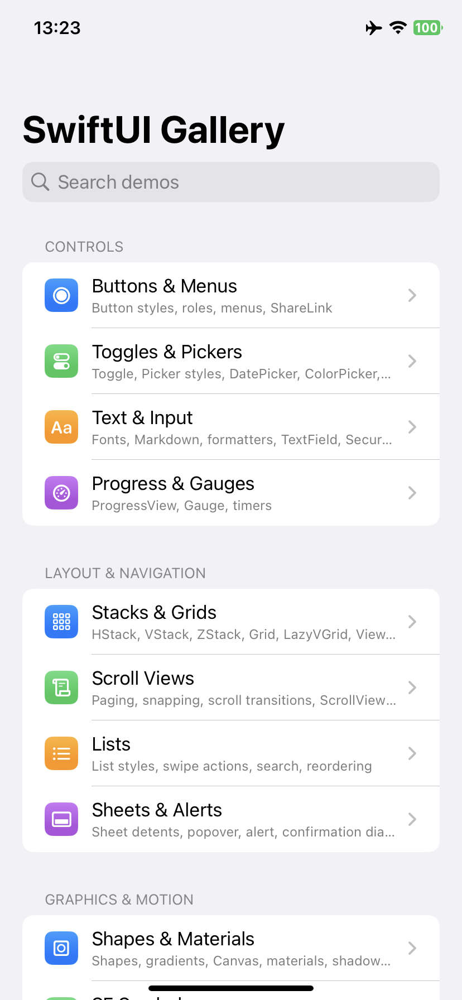
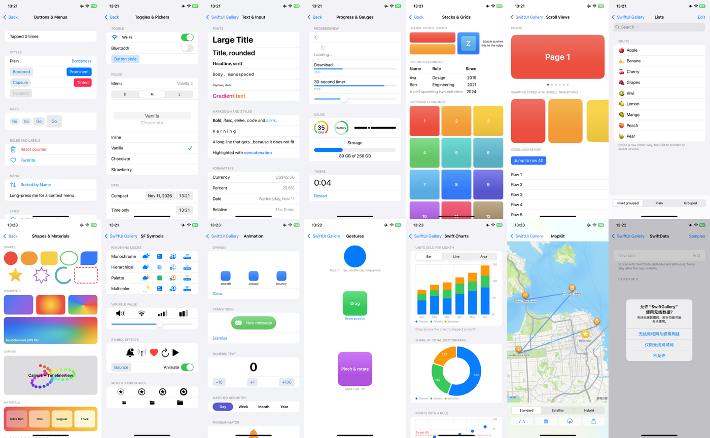

<div align="center">

# SwiftUI Gallery

[English](README.md) · **简体中文**

一个应用里集中展示 15 个 SwiftUI 示例：控件、文本与格式化、进度与仪表、堆栈与网格、滚动视图、列表、弹层与提醒、图形与材质、SF Symbols、动画、手势、Swift Charts、MapKit 和 SwiftData。<br/>
纯 SwiftUI 实现，不依赖第三方包，最低支持 iOS 17。<br/>
在 Windows、Linux、macOS 上用 [KXBuild](https://github.com/kxbuild/kxbuild) 即可编译并安装到 iPhone 上运行。



</div>

## 包含内容

| 分类 | 示例 | 展示内容 |
|---|---|---|
| **控件** | Buttons & Menus | 按钮样式、控件尺寸、角色、`Menu`、上下文菜单、`Link`、`ShareLink` |
| | Toggles & Pickers | `Toggle`，菜单 / 分段 / 滚轮 / 内联 `Picker`，`DatePicker`（紧凑、日历），`ColorPicker`、`Slider`、`Stepper` |
| | Text & Input | 字体样式与字体设计、Markdown、渐变文字、格式化样式、`TextField`、`SecureField`、`TextEditor`、键盘工具栏 |
| | Progress & Gauges | `ProgressView`（不确定、数值、计时器）、`Gauge` 各种样式、实时计时 |
| **布局与导航** | Stacks & Grids | `HStack` / `VStack` / `ZStack`、可跨列的 `Grid`、`LazyVGrid`、`ViewThatFits`、叠加层 |
| | Scroll Views | 分页、按视图对齐吸附、`scrollTransition`、`ScrollViewReader` |
| | Lists | 插入分组 / 普通 / 分组样式、滑动操作、`searchable`、排序与多选 |
| | Sheets & Alerts | 表单高度档位、全屏覆盖、弹出框、检查器、带输入框的提醒、确认对话框 |
| **图形与动效** | Shapes & Materials | 内置与自定义形状，线性 / 径向 / 角度 / 网格渐变，`Canvas` + `TimelineView`，材质、混合模式、遮罩 |
| | SF Symbols | 渲染模式、可变值、符号动效、粗细与尺寸 |
| | Animation | 弹簧、转场、数字过渡、`matchedGeometryEffect`、`PhaseAnimator`、`KeyframeAnimator` |
| | Gestures | 单击、双击、长按、拖动、缩放与旋转组合 |
| **框架** | Swift Charts | 柱状 / 折线 / 面积图、图表选择、`SectorMark` 环形图、带 `RuleMark` 的散点 |
| | MapKit | 带标记、标注、折线的 `Map`，地图样式、镜头移动、地图控件 |
| | SwiftData | 基于 `@Model` 与 `@Query` 的待办清单，支持增删和持久化 |

首页支持搜索，应用跟随系统的浅色 / 深色模式。



## 在 iPhone 上运行

准备：已安装 KXBuild（[安装说明](https://github.com/kxbuild/kxbuild/blob/main/README_zh.md)），并配置好[签名](https://github.com/kxbuild/kxbuild/blob/main/README_zh.md)。

```shell
git clone https://github.com/kxbuild/swift-gallery.git
cd swift-gallery

# 编译，安装到 USB 连接的 iPhone 并启动
kxbuild run SwiftGallery.xcodeproj
```

Bundle ID 是 `com.kxbuild.swiftgallery`。如果你的描述文件不包含它，换成你自己的：

```shell
kxbuild project add-setting --project SwiftGallery.xcodeproj --target SwiftGallery --key PRODUCT_BUNDLE_IDENTIFIER --value com.yourcompany.swiftgallery
```

想启动后直接打开某个示例，把它的 id 作为启动参数传入，例如 `--args "-demo charts"`。全部 id 是 [ContentView.swift](SwiftGallery/ContentView.swift) 里 `Demo` 枚举的各个 case。

### 在 VS Code 里开发

安装 KXBuild 扩展，打开本目录，在 KXBuild 视图里选中 iPhone 后按 F5，即可编译、安装并带断点调试。首次编译前就有代码补全。

## 目录结构

```
SwiftGallery/
  SwiftGalleryApp.swift      应用入口与 SwiftData 容器
  ContentView.swift          示例列表、搜索和导航
  Demos/Controls.swift       按钮、开关、文本、进度
  Demos/Layout.swift         堆栈、滚动视图、列表、弹层
  Demos/Graphics.swift       形状、符号、动画、手势
  Demos/Frameworks.swift     Swift Charts、MapKit、SwiftData
```

`SwiftGallery` 文件夹是同步文件夹组，放进去的 Swift 文件会自动加入应用，无需修改工程文件。新增示例：在 `Demo` 里加一个 case，并在 `destination` 里返回它的视图。

## 相关仓库

- [**KXBuild**](https://github.com/kxbuild/kxbuild)：在 Windows、Linux、macOS 上编译、运行、发布 iOS App 的命令行工具和 VS Code 插件
- [UIKit Gallery（Objective-C）](https://github.com/kxbuild/objc-gallery)：14 个 Objective-C 编写的 UIKit 示例，所有视图都在代码里创建
- [Flutter Gallery](https://github.com/kxbuild/flutter-gallery)：Material 与 Cupertino 组件，外加四个完整示例应用
- [React Native Gallery](https://github.com/kxbuild/react-native-gallery)：16 个 React Native 内置组件与 API 示例
- [Expo Gallery](https://github.com/kxbuild/expo-gallery)：22 个 Expo SDK 模块：相机、传感器、定位、SQLite 等
- [Godot Gallery](https://github.com/kxbuild/godot-gallery)：10 个 Godot 4 示例，导出为 iOS 工程
- [Unity Gallery](https://github.com/kxbuild/unity-gallery)：10 个 Unity 6 示例，导出为 iOS 工程
- [KXBuild 应用模板](https://github.com/kxbuild/kxbuild-app-templates)：`kxbuild project create` 和 `add-target` 使用的项目与 target 模板，欢迎贡献

## 许可证

Apache 2.0，见 [LICENSE](LICENSE)。Swift、SwiftUI 和 SF Symbols 是 Apple Inc. 的商标。
